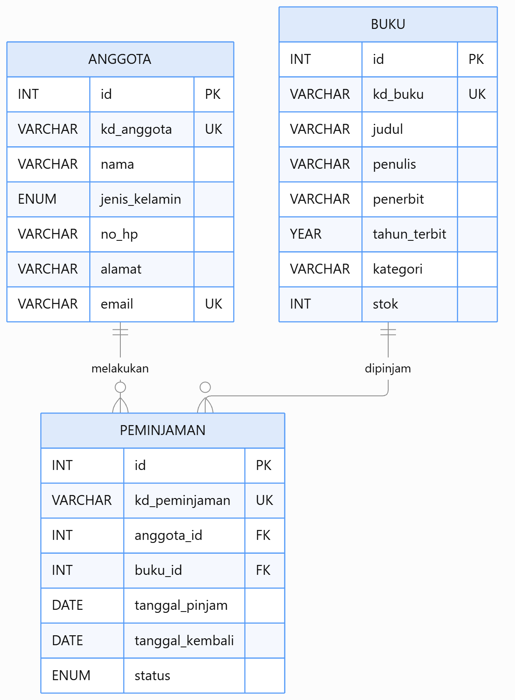

# 📚 TEMA: Perpustakaan

## 1. Deskripsi Project

Project ini merupakan aplikasi REST API Sistem Informasi Perpustakaan yang dibuat untuk memenuhi tugas Ujian Tengah Semester (UTS) mata kuliah Pemrograman Database Client Server.
Sistem ini digunakan untuk mengelola data buku, anggota, dan peminjaman perpustakaan melalui REST API dengan format respons JSON.

## 2. Anggota

| No. | NIM | Nama Anggota | Tugas / Kontribusi |
|:---:|---|---|---|
| 1 | 2511500061 | Muhammad Azka Nazhan | Mencari Tema, Membuat database,table dan seed data, config.php, dan response.php|
| 2 | 2511500063 | Galang Nurhafizd | API anggota beserta ENDPOINT nya |
| 3 | 2511500041 | Argya Zahran Dwiputra Sodikin | API buku beserta ENDPOINT nya |
| 4 | 2511500057 | Steven Marcelino | API peminjaman beserta ENDPOINT nya |

## 3. Entity Relationship Diagram (ERD)

Berikut merupakan rancangan ERD Sistem Informasi Perpustakaan.



## 4. Daftar Endpoint API

**Base URL:**

`http://localhost/uts-perpustakaan`

### 4.1 Endpoint Anggota

**File:** `api/anggota.php`

| Method | URL | Body | Response |
|---|---|---|---|
| GET | `/api/anggota.php` | - | 200 |
| GET | `/api/anggota.php?id=1` | - | 200 / 404 |
| GET | `/api/anggota.php?search=galang` | - | 200 |
| GET | `/api/anggota.php?page=1&limit=5` | - | 200 |
| POST | `/api/anggota.php` | JSON anggota | 201 / 400 / 409 |
| PUT | `/api/anggota.php?id=6` | JSON anggota | 200 / 400 / 404 / 409 |
| DELETE | `/api/anggota.php?id=6` | - | 200 / 404 |

**Contoh Body POST dan PUT:**

```json
{
  "kd_anggota": "AGT006",
  "nama": "Rido",
  "jenis_kelamin": "Laki-laki",
  "no_hp": "081234567890",
  "alamat": "Jl. Depati Hamzah Pangkalpinang",
  "email": "rido@gmail.com"
}
```

### 4.2 Endpoint Buku

**File:** `api/buku.php`

| Method | URL | Body | Response |
|---|---|---|---|
| GET | `/api/buku.php` | - | 200 |
| GET | `/api/buku.php?id=1` | - | 200 / 404 |
| GET | `/api/buku.php?search=laut` | - | 200 |
| GET | `/api/buku.php?page=1&limit=5` | - | 200 |
| POST | `/api/buku.php` | JSON buku | 201 / 400 / 409 |
| PUT | `/api/buku.php?id=6` | JSON buku | 200 / 400 / 404 / 409 |
| DELETE | `/api/buku.php?id=6` | - | 200 / 404 |

**Contoh Body POST dan PUT:**

```json
{
  "kd_buku": "BK006",
  "judul": "Naruto",
  "penulis": "kishimoto",
  "penerbit": "gramed",
  "tahun_terbit": "2014",
  "kategori": "komik",
  "stok": "8"
}
```

### 4.3 Endpoint Peminjaman

**File:** `api/peminjaman.php`

| Method | URL | Body | Response |
|---|---|---|---|
| GET | `/api/peminjaman.php` | - | 200 |
| GET | `/api/peminjaman.php?id=1` | - | 200 / 404 |
| GET | `/api/peminjaman.php?search=steven` | - | 200 |
| GET | `/api/peminjaman.php?page=1&limit=5` | - | 200 |
| POST | `/api/peminjaman.php` | JSON peminjaman | 201 / 400 / 404 / 409 |
| PUT | `/api/peminjaman.php?id=6` | JSON peminjaman | 200 / 400 / 404 |
| DELETE | `/api/peminjaman.php?id=6` | - | 200 / 404 |

**Contoh Body POST dan PUT:**

```json
{
  "kd_peminjaman": "PMJ006",
  "anggota_id": 1,
  "buku_id": 1,
  "tanggal_pinjam": "2026-11-01",
  "tanggal_kembali": "2026-11-08",
  "status": "Dikembalikan"
}
```

**Keterangan Response HTTP:**

| Status Code | Keterangan |
|---|---|
| 200 | Request berhasil |
| 201 | Data berhasil ditambahkan |
| 400 | Validasi data gagal |
| 404 | Data atau relasi tidak ditemukan |
| 409 | Data duplikat |
| 405 | Method tidak diizinkan |
| 500 | Terjadi kesalahan server |

**Format Response JSON:**

```json
{
    "status": true,
    "message": "berhasil",
    "data": []
}
```
 
## 5. Cara Menjalankan Project

1. Clone atau download repository GitHub.
2. Pindahkan folder project ke direktori `www` Laragon.
3. Buka aplikasi Laragon.
4. Klik **Start All** untuk menjalankan Apache dan MySQL.
5. Buka phpMyAdmin melalui browser.
6. Import file `database/perpustakaan.sql`.
7. Pastikan database berhasil dibuat dan seluruh tabel berhasil diimport.
8. Periksa konfigurasi koneksi database pada file `config.php`.
9. Buka project menggunakan Visual Studio Code.
10. Buka Thunder Client.
11. Jalankan dan uji seluruh endpoint API menggunakan method GET, POST, PUT, dan DELETE.